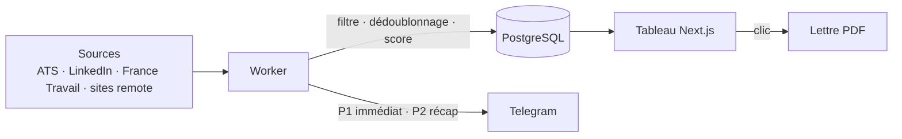

# Find Me Job

Un outil personnel qui surveille les offres d'emploi en continu, les note selon mon profil et m'alerte sur Telegram dès qu'une offre très pertinente est publiée.

Je l'ai construit pour ma propre recherche d'emploi (développeur full stack, intégration IA, DevOps, chef de projet / PO). Il tourne aujourd'hui sur mon Mac, avec Docker, en attendant un serveur maison.

## Le problème

Une offre intéressante reçoit souvent des centaines de candidatures dans ses premières heures. Pour être lu, il faut postuler tôt. Il faut aussi postuler aux bonnes offres, pas à tout.

Chercher à la main sur une dizaine de sites, plusieurs fois par jour, prend beaucoup de temps et laisse passer des offres. Il est aussi difficile de juger vite si une offre correspond vraiment : bonne zone, vrai remote, salaire suffisant, bon niveau d'expérience.

## Ce que fait l'outil

1. **Collecte en continu.** Toutes les 10 à 30 minutes, il interroge plusieurs sources :
   - les pages carrières d'une quarantaine d'entreprises (via les API publiques Greenhouse, Lever et Ashby) ;
   - les offres publiques de LinkedIn ;
   - France Travail ;
   - des sites d'offres en remote (Remote OK, Remotive, Himalayas, We Work Remotely).
2. **Nettoyage.** Il filtre les titres hors sujet, regroupe les doublons publiés sur plusieurs sites et récupère la description quand la source ne la fournit pas.
3. **Score de fit sur 100**, calculé par un algorithme et expliqué point par point dans le tableau :
   - **titre (45 points)** : catégorie de poste visée ;
   - **compétences (25 points)** : celles de mon stack trouvées dans l'offre ;
   - **localisation (20 points)** : sur site, hybride ou remote, selon la zone ;
   - **salaire (10 points)** : montant extrait de l'annonce, converti en euros annuels ;
   - **pénalités** :
     - années d'expérience demandées comparées à mon expérience dans ce métier ;
     - diplôme exigé ;
     - autre langue requise ;
     - écosystème éditeur que je ne maîtrise pas (SAP, Dynamics…) ;
     - expérience de lead exigée.
4. **Exclusions automatiques.** Une offre est masquée, avec la raison affichée, dans ces cas :
   - sur site hors de ma zone ;
   - « remote » réservé à un autre pays ;
   - salaire sous mon plancher ;
   - stage ou alternance ;
   - poste senior dans un métier que je n'ai jamais exercé.
5. **Fraîcheur.** Le score final ajoute un bonus aux offres de moins de 24 h et pénalise les vieilles offres. Il est recalculé toutes les 15 minutes.
6. **Priorisation et alertes.**
   - **P1** : alerte Telegram immédiate, avec des boutons *À postuler / Postulé / Ignorer*.
   - **P2** : récapitulatif à 9 h et 18 h.
   - **P3** : visible seulement dans le tableau.
7. **Candidature en un clic.** Pour chaque offre, le tableau indique quel CV envoyer, choisi selon la catégorie du poste et la langue de l'offre. Il génère aussi une **lettre de motivation propre à l'offre**, en PDF, au moment du clic.

## Choix techniques

- **Un score déterministe, pas de LLM (pour l'instant).** Chaque point du score a une raison lisible : « −10 : 5 ans d'exp. demandés », « hybride hors zone »… Je peux corriger une règle quand le tri se trompe, et le coût par offre est nul. Un score par LLM est prévu en complément, pas en remplacement.
- **Détection du vrai mode de travail.** Le filtre « télétravail » de LinkedIn se fie à ce que déclare l'entreprise. L'outil relit la description pour repérer les faux remote : « 3 jours au bureau », « office-first », « remote-friendly »…
- **Extraction de salaire robuste.** Elle gère les fourchettes (« 42-50k€ »), les devises, la période (an, mois, jour, heure) et les faux positifs (« $100M raised »).
- **Collecte respectueuse des sources.**
  - Les pages LinkedIn sont lues sans compte connecté, avec des requêtes groupées et une pause automatique quand le site répond « trop de requêtes » (HTTP 429).
  - Le quota de Remotive (4 appels par jour) est respecté, et chaque offre affiche sa source avec un lien vers l'annonce d'origine.
- **Pas d'alerte au premier passage.** Lors de sa première collecte, une source enregistre les offres déjà en ligne sans envoyer de notification. Seules les vraies nouveautés déclenchent une alerte.
- **Des lettres sans invention.** Les lettres sont assemblées à partir de réalisations réelles, choisies selon les mots-clés de l'offre. Elles ne citent que des compétences de ma liste blanche : si l'offre demande une technologie que je n'ai pas pratiquée, la lettre ne prétend pas la maîtriser.
- **Données personnelles hors du dépôt.** Les coordonnées, le salaire visé, les tokens et les CVs restent dans `.env` et dans des fichiers ignorés par git.

## Stack

| | |
|---|---|
| Langage | TypeScript |
| Tableau | Next.js 16 (App Router), React 19 |
| Worker | Node.js (`tsx`) : boucles de collecte, bot Telegram (long polling), tâches planifiées |
| Base de données | PostgreSQL 17 |
| Parsing | cheerio (HTML), fast-xml-parser (flux RSS) |
| PDF | Chrome headless (lettres et CVs générés depuis des modèles HTML) |
| Déploiement | Docker / docker-compose |



## Organisation du code

```
config/
  profile.ts      profil de recherche : catégories, compétences, zones, pénalités, seuils
  companies.ts    entreprises suivies via leur ATS
  letters.ts      accroches, réalisations et compétences utilisées par les lettres
src/
  sources/        un connecteur par source (ATS, LinkedIn, France Travail, sites remote)
  scoring/        score de fit, mode de travail, salaire, fraîcheur
  worker/         planification et pipeline d'ingestion
  notify/         bot Telegram (alertes, récapitulatifs, commandes /top /stats)
  letters/        génération des lettres de motivation (HTML → PDF)
  app/            tableau et API (Next.js)
  db/             schéma SQL
cvs/src/          gabarit et génération des CVs (les données des CVs ne sont pas publiées)
```

## Lancer le projet

```bash
cp .env.example .env         # puis renseigner le mot de passe Postgres, le token Telegram, les coordonnées, le salaire
npm install
docker compose up -d db      # PostgreSQL (port 5433)
npm run worker               # collecte + scoring + bot Telegram
npm run dev                  # tableau → http://localhost:3100
```

Tout en Docker (serveur maison) :

```bash
docker compose --profile full up -d --build
```

Autres commandes :

```bash
npm run once                 # un passage de toutes les sources, puis arrêt
npm run once -- linkedin     # une seule source
npm run rescore              # recalcule tous les scores après un changement de config/profile.ts
```

## Prochaines étapes

- Score complémentaire par LLM pour les offres de la zone grise (P2/P3).
- Activer la source France Travail (identifiants d'API à créer).
- Hébergement sur un serveur maison.
